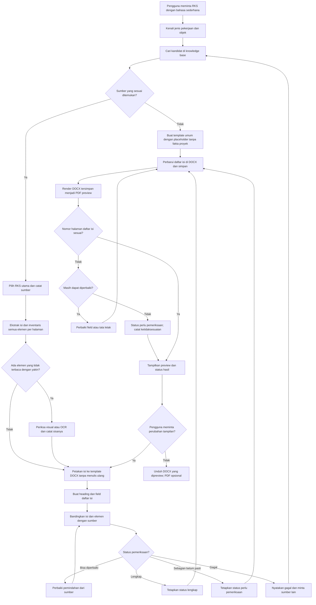
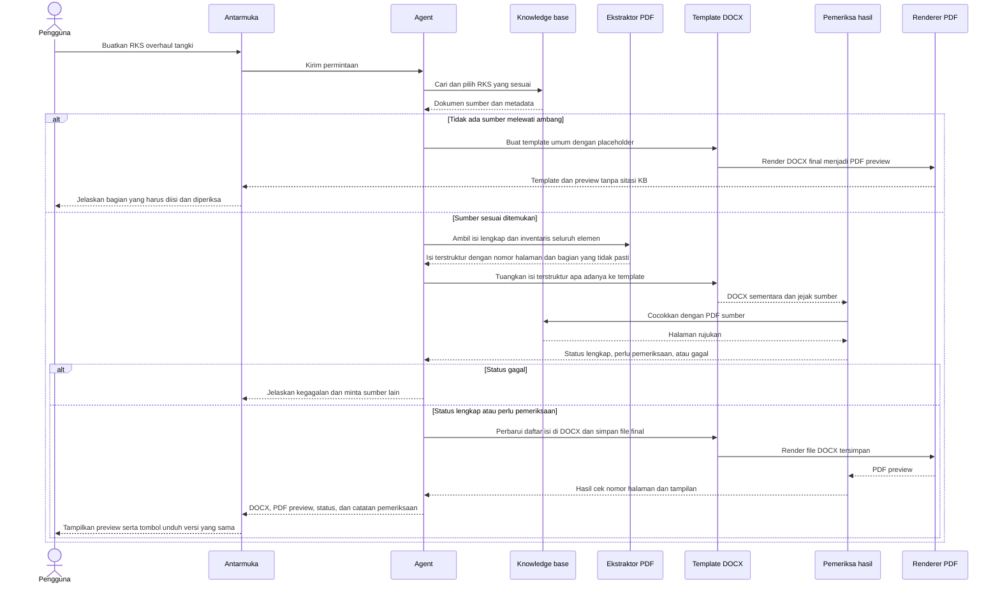

# Alur Pembuatan RKS dari Knowledge Base

## 1. Tujuan dan keputusan desain

Pengguna yang belum berpengalaman dapat meminta, misalnya, “Buatkan saya dokumen RKS overhaul tangki.” Agent memilih RKS yang sesuai dari knowledge base, memindahkan isi sumber ke dokumen baru dari sampul sampai bagian terakhir yang tersedia, lalu menghasilkan DOCX yang rapi dan dapat diedit.

Fokus tahap ini adalah **kerapian dan keterbacaan dokumen**. Isi RKS mengikuti knowledge base yang dimiliki proyek. Agent tidak menilai kebenaran substansi, menulis ulang, memparafrasekan, melengkapi, atau memperbaiki isi sumber.

**Pembagian tugas:** agent memahami permintaan, memilih sumber, dan membantu mengenali struktur bagian. Ekstraktor memindahkan isi sumber ke representasi terstruktur, sedangkan renderer menata representasi itu ke DOCX. Keduanya harus dapat dibandingkan kembali dengan sumber. Model bahasa tidak menulis ulang paragraf, angka, atau isi sel tabel untuk dijadikan isi final.

Hasil diberi identitas sebagai **draf tertata dari RKS referensi** beserta nama sumbernya. Nomor dokumen, nama proyek, lokasi, tanggal, dan data lain dari sumber tetap ditampilkan sebagai data sumber; hasil tidak boleh tampak seolah-olah sudah disesuaikan untuk proyek baru jika pengguna belum meminta dan memberikan datanya.

## 2. Arti “menuangkan isi apa adanya”

- Pertahankan kata, angka, satuan, urutan bagian, tabel, gambar, diagram, rumus, kotak centang, dan cakupan lampiran yang terbaca dari sumber.
- Perubahan yang diperbolehkan hanya pada tata letak: margin, jenis dan ukuran huruf, gaya judul, penomoran tampilan, jarak antarparagraf, pemisahan halaman, header/footer, dan format tabel. Pemindahan baris boleh dilakukan untuk kerapian selama urutan dan makna teks tetap sama.
- Daftar isi dibuat ulang dari judul bagian yang berhasil dikenali agar nomor halaman sesuai DOCX baru. Teks daftar isi PDF yang rusak tidak disalin sebagai daftar isi aktif.
- Kesalahan ketik, istilah lama, dan data proyek lama dalam sumber tetap dipertahankan. Agent dapat mencatat masalah ekstraksi di ringkasan terpisah tanpa mengubah isi.
- Jika teks atau sel tabel tidak dapat dibaca dengan yakin, tandai bagian tersebut sebagai **perlu pemeriksaan terhadap halaman sumber**. Jangan menebak isinya.
- Jika elemen selain teks tidak dapat dibuat ulang secara setia, pindahkan sebagai gambar dari sumber beserta rujukan halamannya atau tandai sebagai bagian yang perlu diperiksa. Jangan menghilangkannya diam-diam.
- Struktur hasil mengikuti bagian yang benar-benar ada pada RKS acuan. Sistem tidak menambah bab atau lampiran baru hanya untuk memenuhi template.

## 3. Masukan dan keluaran

**Masukan minimal:** permintaan singkat pengguna dan koleksi RKS dalam knowledge base. Pengguna tidak perlu mengisi parameter teknis sebelum melihat hasil awal.

**Keluaran:**

1. DOCX yang memuat isi RKS acuan dalam format seragam dan dapat diedit.
2. Preview per halaman yang dirender dari DOCX final tersebut, bukan tampilan teks terpisah.
3. Ringkasan singkat berisi dokumen sumber, status hasil (`lengkap`, `perlu pemeriksaan`, atau `gagal`), jumlah halaman/bagian yang dipindahkan, keberadaan BOQ, dan bagian yang belum dapat dipindahkan dengan yakin.
4. Jejak sumber internal per bagian atau tabel: nama file dan nomor halaman PDF asal.

Jika beberapa RKS sama-sama relevan, sistem memilih kandidat peringkat pertama secara konsisten dan menampilkan alternatif serta catatan bahwa pengguna perlu mencocokkan proyeknya. Jika tidak ada sumber yang melewati ambang, sistem membuat template umum dengan placeholder yang jelas belum didukung knowledge base. Jika sumber terpilih tidak lengkap atau sebagian halaman tidak dapat dibaca, sistem menyatakan keterbatasan tersebut secara jelas pada hasil.

## 4. Alur pengguna

### Tahap 1 — Cari dan pilih RKS acuan

Agent mengenali jenis pekerjaan dan objek dari kalimat pengguna, lalu mencari kandidat RKS. Pemilihan mempertimbangkan jenis pekerjaan, objek/aset, dan kecocokan ruang lingkup. Misalnya, RKS *overhaul* tangki tidak dicampur dengan RKS pembangunan tangki baru hanya karena keduanya menyebut tangki.

Agent memilih satu dokumen utama yang paling cocok dan mencatat nama serta halaman sumber. Pencarian kata kunci mempertahankan kode aset persis; pencarian semantik PGVector dapat menambah bukti per bagian. Ambang dan jumlah hasil dapat dikonfigurasi. Jika tidak ada kandidat yang memadai, renderer membuat template umum berisi struktur dan placeholder, tanpa menulis fakta proyek dari ingatan model.

### Tahap 2 — Ambil isi lengkap beserta struktur

Ekstraktor membaca seluruh dokumen terpilih, termasuk sampul, bab, subbab, tabel, gambar, diagram, rumus, kotak centang, dan lampiran yang ada. Teks diambil menurut urutan baca halaman, sementara tabel diambil menurut baris dan kolom. Setiap elemen dicatat dalam inventaris dengan jenis dan nomor halaman asal; agent hanya membantu mengenali struktur dan memilih sumber.

Hasil ekstraksi dicek terhadap tampilan PDF agar header/footer yang berulang, kolom yang tertukar, kata yang terpotong, sel tabel yang bergabung, dan elemen visual yang hilang tidak diam-diam menjadi isi RKS. Halaman yang memiliki lapisan teks tetapi susunannya rusak tetap dapat memerlukan OCR atau pemeriksaan visual; jumlah karakter saja bukan ukuran kualitas ekstraksi.

### Tahap 3 — Tuangkan ke template DOCX

Renderer menempatkan isi yang telah diekstrak ke template RKS dengan gaya yang konsisten. Template mengatur tampilan, bukan mengganti susunan atau isi sumber. Sampul, judul, paragraf, daftar, tabel, elemen visual, dan lampiran dirender sesuai jenis elemennya. Daftar isi DOCX dibuat dari heading hasil pemetaan. Renderer tidak meminta model bahasa membuat ulang isi yang gagal diekstrak.

### Tahap 4 — Periksa kesetiaan dan kerapian

Sistem membandingkan hasil dengan sumber: urutan bagian, keberadaan paragraf, tabel dan elemen visual, isi sel, angka, satuan, serta lampiran. Sistem juga memeriksa margin, halaman, daftar isi, tabel yang terpotong, dan keterbacaan DOCX.

Perbedaan isi yang tidak dapat dijelaskan oleh perubahan tata letak harus diperbaiki atau diberi catatan pemeriksaan. Hasil diberi status **`lengkap`** jika seluruh elemen yang diperlukan terbaca dan cocok dengan sumber, **`perlu pemeriksaan`** jika ada bagian terbatas yang belum dapat dipindahkan dengan yakin, atau **`gagal`** jika sumber tidak dapat diproses secara memadai. Status `perlu pemeriksaan` boleh menghasilkan draf bertanda dan daftar halaman/elemen yang harus dicek; status `gagal` tidak menghasilkan dokumen yang diklaim lengkap dan mengarahkan pengguna memilih sumber lain.

| Status | Kriteria | Hasil untuk pengguna |
|---|---|---|
| `lengkap` | Seluruh bagian dan elemen yang ada pada sumber terpetakan dan cocok pada pemeriksaan | Preview dan DOCX siap ditinjau serta diunduh |
| `perlu pemeriksaan` | Ada elemen terbatas yang tidak pasti, tetapi sebagian besar dokumen dapat dipindahkan | Draf bertanda, preview, dan daftar halaman/elemen yang perlu dicek; tidak disebut lengkap |
| `gagal` | Sumber tidak tersedia atau bagian penting tidak dapat diekstrak secara memadai | Penjelasan masalah dan pilihan sumber lain; tidak ada klaim DOCX lengkap |

### Tahap 5 — Buat preview dari DOCX final

Setelah isi DOCX selesai, sistem memperbarui field daftar isi dan nomor halaman **di dalam DOCX**, menyimpan ulang file tersebut, lalu merender **file tersimpan yang sama** menjadi PDF. Nomor halaman pada daftar isi dalam DOCX dan PDF preview dibandingkan dengan halaman sebenarnya; jika pembaruan menggeser halaman, proses diulang sampai stabil. Jika tetap tidak sesuai, hasil diberi status `perlu pemeriksaan` dan ketidaksesuaian disebutkan sebelum unduhan. Antarmuka menampilkan PDF itu sebagai preview agar pengguna dapat melihat sampul, daftar isi, paragraf, tabel, lampiran, dan pergantian halaman sebagaimana hasil render.

Jika dokumen diubah atau referensi diganti, sistem membuat ulang DOCX dan PDF preview sebagai satu pasangan versi. Preview lama tidak boleh ditampilkan bersama tombol unduh DOCX versi baru. Bila konversi PDF gagal, antarmuka menyatakan preview belum tersedia dan tidak menampilkan hasil lama seolah-olah masih berlaku.

### Tahap 6 — Serahkan hasil

Pengguna meninjau halaman preview sebelum mengunduh DOCX dan menerima ringkasan sumber beserta status hasil. Untuk status `perlu pemeriksaan`, antarmuka menampilkan halaman/elemen yang belum pasti secara jelas. PDF yang sama dapat disediakan sebagai unduhan tambahan jika diperlukan. Agent menjelaskan bahwa isi mengikuti RKS referensi yang dipilih, termasuk data proyek pada dokumen asal. Pengguna dapat meminta penggantian referensi atau perapian tampilan lebih lanjut.

## 5. Diagram alur utama

## 6. Diagram interaksi komponen

## 7. Perlakuan khusus untuk BOQ

BOQ pada jalur RKS **hanya dituangkan sejauh tersedia di knowledge base dan jelas terkait dengan RKS yang dipilih**:

- Jika tabel BOQ ada, pindahkan baris, kolom, uraian, angka, dan satuannya apa adanya ke tabel DOCX yang lebih mudah dibaca.
- Jika BOQ tersimpan sebagai dokumen terpisah di knowledge base dan hubungannya dengan RKS acuan jelas, sertakan sebagai lampiran dengan sumbernya. Jangan menggabungkan BOQ dari proyek lain hanya karena nama pekerjaannya mirip.
- Jika sumber hanya menyebut atau merujuk BOQ dari dokumen lain, pertahankan kalimat rujukan tersebut. Ringkasan hasil menyatakan bahwa tabel BOQ tidak tersedia di RKS acuan.
- Jika tabel hanya terbaca sebagian, pindahkan bagian yang terbaca dan tandai halaman/sel yang memerlukan pemeriksaan.
- Jika tidak ada BOQ, jangan membuat tabel kosong, item, volume, harga, ataupun total baru.

Pengunggahan dan pengisian BOQ yang diperlukan untuk **Dokumen Tender** berada pada alur Tender Generator tersendiri. Pada alur itu sistem dapat meminta dokumen BOQ kepada pengguna. Ketiadaan BOQ tidak menghalangi pembuatan draf RKS yang setia pada sumbernya.

## 8. Standar tampilan DOCX

Template keluaran perlu menentukan satu set aturan yang konsisten:

- ukuran halaman dan margin yang sama pada halaman isi, dengan aturan khusus bila sampul membutuhkan komposisi berbeda;
- gaya heading bertingkat untuk bab dan subbab;
- daftar isi otomatis berdasarkan heading DOCX, bukan hasil salin dari PDF;
- font, spasi, indentasi, dan penomoran yang mudah dibaca;
- header/footer dan nomor halaman yang seragam;
- tabel dengan lebar kolom wajar, judul kolom berulang di halaman berikutnya, serta pemisahan baris yang terkendali;
- penempatan lampiran dan pemisahan halaman yang konsisten.

Nilai ukuran rinci mengikuti template yang disepakati saat implementasi. Template keluaran tidak disebut sebagai format resmi Pertamina sebelum ada template resmi yang diberikan atau disetujui.

## 9. Preview halaman dan kesesuaian dengan ekspor

**DOCX final menjadi sumber tunggal untuk preview dan unduhan.** Alurnya adalah `isi terstruktur → DOCX final → PDF preview`. Antarmuka menampilkan halaman PDF dengan navigasi dan perbesaran; tidak membuat tiruan halaman memakai HTML atau teks chat. Dengan demikian, PDF preview dan PDF unduhan opsional dapat identik karena berasal dari file render yang sama.

Renderer dokumen di server, misalnya LibreOffice dalam mode tanpa antarmuka, diperlukan untuk mengubah DOCX menjadi PDF. Lingkungan produksi perlu memiliki font yang digunakan template. Proses render juga perlu memperbarui field daftar isi **pada file DOCX yang akan diunduh**, menyimpannya, lalu memeriksa nomor halaman pada DOCX dan PDF preview. Pembaruan yang hanya terjadi pada PDF tidak memenuhi syarat. Jika renderer belum tersedia di lingkungan, fitur preview memerlukan pemasangan atau penyediaan komponen tersebut saat implementasi.

DOCX yang dibuka di Microsoft Word pada perangkat pengguna dapat mengalami sedikit pergeseran karena perbedaan font atau mesin tata letak. Karena itu, klaim kesamaan **persis** berlaku untuk PDF preview dan PDF hasil render yang sama; DOCX di aplikasi lain ditargetkan sedekat mungkin. Jika pengguna mengubah draf, kedua file dibuat ulang sebelum preview baru ditampilkan.

## 10. Kebutuhan teknis

1. **Indeks dokumen:** menyimpan nama file, jenis pekerjaan, objek/aset, dan metadata sumber untuk memilih RKS yang tepat.
2. **Ekstraksi lengkap:** membaca halaman secara berurutan, termasuk blok teks, tabel, dan elemen visual; pertimbangkan OCR untuk halaman tanpa teks yang memadai maupun halaman dengan lapisan teks yang rusak.
3. **Representasi terstruktur:** menyimpan heading, paragraf, daftar, tabel, gambar, diagram, rumus, kotak centang, lampiran, serta nomor halaman asal sebelum dirender.
4. **Pemeriksaan ekstraksi:** mendeteksi teks hilang/duplikat, urutan kolom salah, sel tabel yang gagal dipetakan, dan elemen visual yang terlewat.
5. **Renderer DOCX:** menerapkan template dari representasi terstruktur dan membuat daftar isi tanpa meminta model bahasa menulis ulang isi sumber.
6. **Renderer PDF:** mengubah DOCX final menjadi PDF preview menggunakan font dan konfigurasi render yang konsisten.
7. **Penyajian preview:** menampilkan PDF per halaman serta menjaga pasangan DOCX–PDF tetap berasal dari versi yang sama.
8. **Pemeriksaan hasil:** membandingkan semua elemen dengan sumber, menetapkan status kelengkapan, serta meninjau tampilan halaman pada preview.

Alur `rag/doc_loader.py` kini memecah teks per halaman dan menyimpan nomor halaman pada chunk baru untuk pencarian semantik. Indeks lama perlu dimigrasikan agar metadata halaman tersedia. Jalur ekstraksi dokumen lengkap tetap terpisah karena chunk pencarian saja tidak menyimpan struktur tabel dan elemen visual yang diperlukan untuk memindahkan seluruh RKS secara setia.

## 11. Tahapan implementasi

### Tahap A — Pilih sumber contoh dan template tampilan

Pilih beberapa RKS dengan jenis pekerjaan yang berbeda. Petakan sampul, heading, tabel, lampiran, dan bagian yang sering tidak terbaca rapi. Tentukan tampilan DOCX yang konsisten.

### Tahap B — Ekstraksi dan representasi isi

Bangun ekstraksi per halaman dan pemetaan struktur. Inventarisasi teks, tabel, gambar, diagram, rumus, kotak centang, dan lampiran beserta halaman asal. Tandai bagian yang tidak dapat dipindahkan secara meyakinkan dan tetapkan kapan OCR atau pemeriksaan visual diperlukan.

### Tahap C — Pemilihan referensi dan renderer

Hubungkan pencarian knowledge base dengan pengambilan dokumen lengkap. Isi template DOCX berdasarkan struktur yang telah diekstrak, termasuk BOQ jika tersedia di sumber.

### Tahap D — Render preview dan periksa hasil

Bandingkan hasil dengan PDF sumber pada sampel yang mewakili paragraf panjang, tabel, elemen visual, daftar isi, dan lampiran. Tetapkan status `lengkap`, `perlu pemeriksaan`, atau `gagal`. Perbaiki pemindahan yang salah, perbarui daftar isi di DOCX, simpan, lalu render file yang sama menjadi PDF preview. Cocokkan nomor halaman daftar isi pada kedua hasil.

### Tahap E — Pengalaman pengguna

Sediakan satu permintaan sederhana untuk membuat RKS, tampilkan sumber yang dipilih otomatis, status hasil, dan preview halaman. Berikan file yang sama dengan hasil preview untuk status `lengkap` atau draf bertanda untuk status `perlu pemeriksaan`; jelaskan kegagalan tanpa klaim file lengkap untuk status `gagal`. Jika sumber tidak ditemukan, buat template umum berplaceholder dan jelaskan bahwa ia belum berbasis sumber KB.

## 12. Kriteria selesai untuk tahap ini

- DOCX memuat seluruh bagian yang berhasil dibaca dari sampul sampai bagian terakhir sumber, dalam urutan yang benar.
- Teks, angka, satuan, isi tabel, elemen visual, dan cakupan lampiran sama dengan sumber; tidak ada parafrasa atau data baru dari model bahasa.
- Setiap elemen sumber tercatat dengan jenis dan halaman asal; elemen yang tidak dapat dipindahkan secara setia tidak hilang diam-diam.
- Status `lengkap`, `perlu pemeriksaan`, dan `gagal` mengikuti kriteria yang sama pada alur, preview, ringkasan, dan unduhan.
- Daftar isi dan nomor halamannya sesuai di DOCX yang diunduh maupun PDF preview.
- Margin, heading, spasi, nomor halaman, serta tabel konsisten dan terbaca.
- Preview menampilkan semua halaman dari PDF yang dirender dari DOCX final yang tersedia untuk diunduh.
- Perubahan dokumen memperbarui DOCX dan preview bersama; preview lama tidak tersaji sebagai versi baru.
- Daftar isi, pergantian halaman, dan tabel pada preview diperiksa sebelum hasil diberikan.
- BOQ ditampilkan hanya sesuai ketersediaannya pada knowledge base.
- Nama file dan halaman asal dapat ditelusuri.
- Bagian yang tidak terbaca atau tidak lengkap disebutkan secara jelas.
- Pengguna pemula dapat memperoleh hasil awal tanpa harus memahami struktur RKS.

## 13. Batas tahap ini

Tahap ini menilai **kesetiaan pemindahan isi dan kualitas format**. Pemeriksaan apakah ketentuan teknis, hukum, atau pengadaan dalam sumber benar dan mutakhir berada di luar target tahap ini. Sebelum digunakan sebagai dokumen resmi, hasil tetap perlu ditinjau oleh pihak yang berwenang.

## 14. Status implementasi pada 6 November 2026

Alur tersedia melalui menu **Pembuatan RKS dan preview** pada Streamlit, tool agent `create_rks_document`, CLI, dan endpoint `/api/rks`. Implementasi berada di `tools/rks/` dengan panduan pada [README modul RKS](tools/rks/README.md).

- Pencarian memakai katalog PDF asli dalam `data/`, membedakan jenis pekerjaan, memilih sumber otomatis, lalu mencari bukti per bagian melalui kata kunci dan PGVector bila tersedia. Hasil dengan skor sama disertai catatan dan alternatif. Tanpa sumber yang memenuhi ambang, hasilnya adalah template umum dengan placeholder.
- Ekstraksi dan renderer bekerja tanpa generasi ulang teks oleh model. Keluaran RKS memetakan lapisan teks, heading, dan tabel bergaris PDF ke struktur Word editable. Sampul formal dibentuk secara dinamis dari judul, pekerjaan, risiko, dan perusahaan pada dokumen sumber; heading Word digunakan untuk daftar isi.
- DOCX dan PDF disimpan sebagai pasangan versi dengan hash; unduhan menolak file yang berubah setelah finalisasi.
- Adapter Word pada Windows sudah diuji untuk memperbarui daftar isi di DOCX, menyimpannya, memeriksa bookmark tujuan, lalu merender PDF. Adapter LibreOffice tersedia, tetapi verifikasi nomor halaman daftar isinya masih menghasilkan status perlu pemeriksaan.
- Gambar halaman tidak dimasukkan ke DOCX RKS. Simbol yang tidak terbaca ditandai dalam teks; logo, tanda centang, diagram, serta struktur sel gabungan yang tidak dapat dipetakan tetap memerlukan pemeriksaan terhadap PDF asli. Halaman tanpa lapisan teks memerlukan transkripsi manual.
- BOQ mengikuti sumber terpilih. Penggabungan otomatis dengan BOQ terpisah belum diaktifkan tanpa metadata hubungan sumber yang dapat dipastikan.

Verifikasi terbaru mencakup 23 pengujian regresi. Sampel overhaul tangki 041T304 berbasis teks berhasil dirender melalui Word: 33 entri daftar isi cocok dengan halaman tujuan, tidak ada token literal hasil ekstraksi yang hilang, dan DOCX tidak memiliki gambar. Hasil tetap perlu pemeriksaan terhadap PDF sumber karena elemen grafis serta hubungan sel tabel tidak tersalin sebagai teks. Template umum tiga halaman juga berhasil dirender dari DOCX final.
