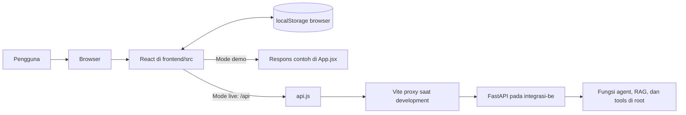
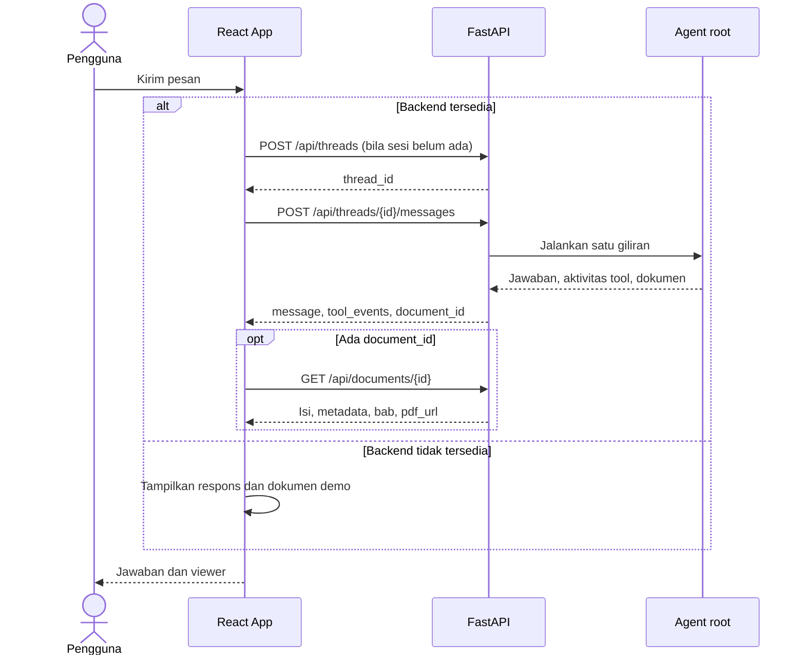
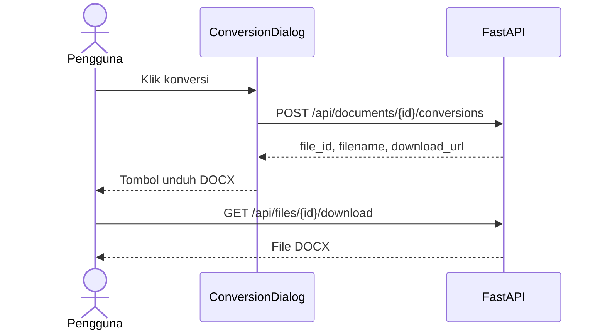

# HLD — Frontend Pertamina Document Assistant

Dokumen ini menjelaskan desain tingkat tinggi frontend pada branch `integrasi-fe`. Diagram memakai Mermaid agar dapat dilihat langsung di GitHub dan editor yang mendukung Mermaid. Implementasi utamanya berada di `frontend/src/`.

## 1. Batas sistem



Pada development, browser membuka Vite di port `5173`. Permintaan `/api` diteruskan oleh `vite.config.js` ke FastAPI di `127.0.0.1:8000`. Pada deployment nanti, hasil `npm run build` perlu disajikan bersama rute `/api`; Vite dev server tidak diperlukan.

## 2. Komponen frontend

```mermaid
flowchart TB
    App[App.jsx: chat, sesi, mode, dan state] --> Panel[DocumentPanel.jsx: isi, bab, PDF]
    App --> Dialog[ConversionDialog.jsx: konversi dan unduhan]
    App --> Api[api.js: permintaan HTTP]
    App --> Demo[createDemoResponse: data contoh]
    App <--> Store[(localStorage: tampilan riwayat)]
    Api --> Endpoints[/api/health, threads, messages, documents, conversions, files]
    Styles[styles.css dan chat-style.css] --> App
    Styles --> Panel
    Styles --> Dialog
```

| Komponen | Tanggung jawab |
| --- | --- |
| `App.jsx` | Memilih mode demo/live, mengelola chat dan sesi pada browser, mengirim pesan, serta membuka viewer. |
| `api.js` | Membungkus `fetch`, mengubah respons error API menjadi pesan untuk UI, dan membangun permintaan ke `/api`. |
| `DocumentPanel.jsx` | Menampilkan isi dan daftar bab; membuka PDF sumber bila `pdf_url` tersedia. |
| `ConversionDialog.jsx` | Meminta konversi PDF dan menampilkan tautan DOCX setelah API mengembalikannya. |
| `vite.config.js` | Meneruskan `/api` ke backend selama development. |

## 3. Alur chat dan dokumen



Frontend memeriksa `/api/health` saat halaman dibuka. Tombol status di kanan atas dapat dipakai untuk memeriksa ulang koneksi. Kesalahan API saat mode live ditampilkan kepada pengguna; frontend tidak diam-diam menggantinya dengan jawaban demo.

## 4. Alur konversi



Konversi hanya aktif dalam mode live jika dokumen mempunyai PDF sumber. Dalam mode demo, tombol tidak menghasilkan file.

## 5. Data, dependensi, dan batasan

- `localStorage` menyimpan tampilan percakapan, dokumen terakhir, dan ID sesi backend pada browser. Ini bukan penyimpanan resmi sesi agent.
- Sesi agent pada backend masih disimpan di memori proses. Setelah backend dimulai ulang, frontend membuat sesi backend baru saat pesan berikutnya dikirim; riwayat yang terlihat di browser belum otomatis diimpor ke sesi baru.
- Tanpa backend, aplikasi tetap dapat dipakai untuk meninjau desain dan interaksi demo. Jawaban demo bukan hasil pencarian RAG.
- Branch ini tidak berisi folder `backend/`; backend ada pada branch/worktree `integrasi-be`. Tidak ada merge ke `main` dalam tahap ini.
- Mode live membutuhkan FastAPI pada port `8000`, database dan kredensial yang dipakai agent root. Pemeriksaan `/api/health` hanya memastikan API hidup, bukan kesiapan model/database.

## 6. Cara meninjau

Jalankan `npm install` lalu `npm run dev` dari `frontend/`. Lihat [README frontend](../README.md) untuk langkah singkat. Bila backend dijalankan dari worktree `integrasi-be`, refresh halaman atau klik tombol status koneksi untuk beralih ke mode live. Setelah perubahan kontrak API, perbarui dokumen ini, `src/api.js`, dan HLD backend secara bersamaan.
